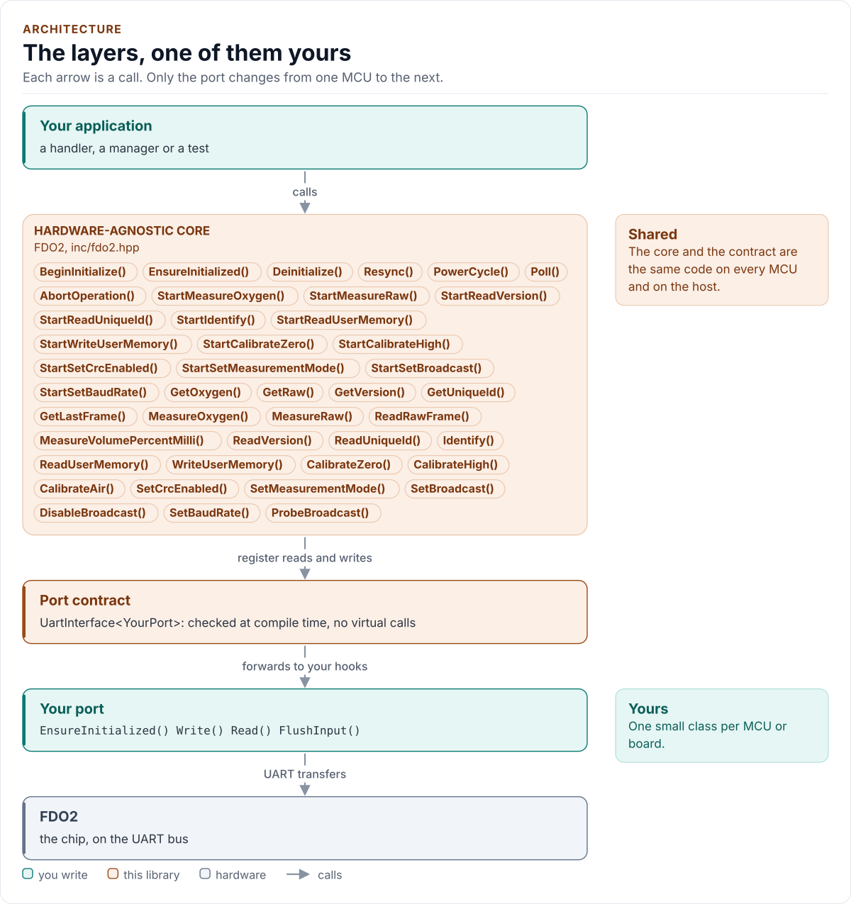
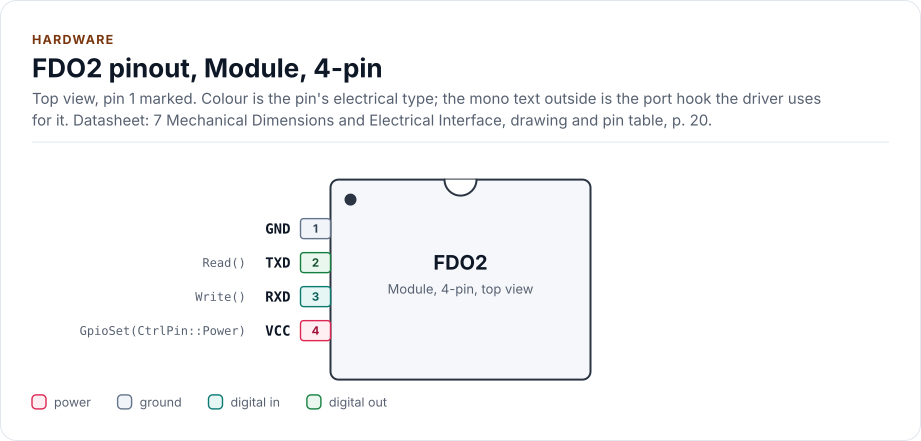
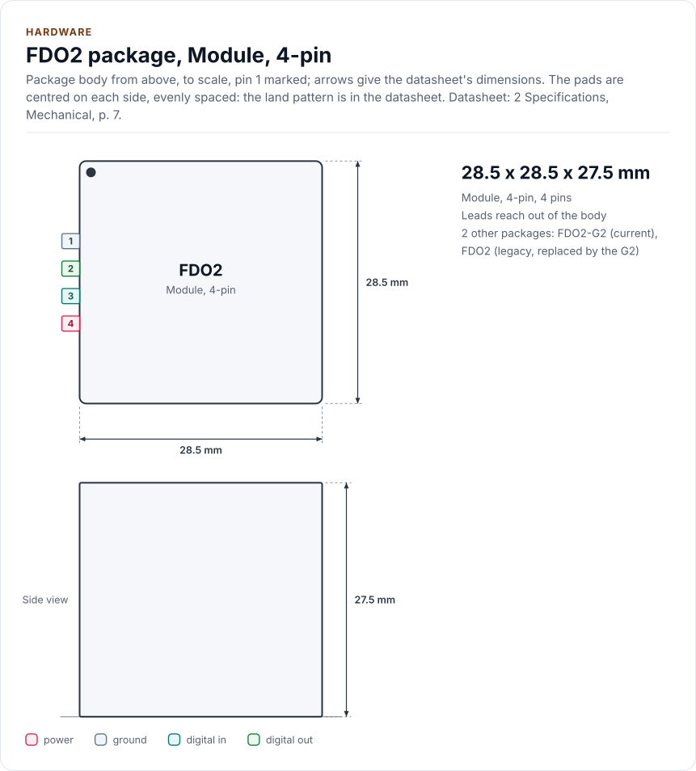
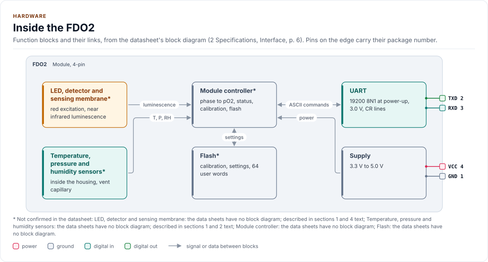

# FDO2 Driver

C++20 driver for the PyroScience FDO2-G2 and FDO2 optical oxygen sensor modules on UART.

[](https://github.com/kokeb-labs-drivers/driver-fdo2/actions/workflows/ci.yml)
[](LICENSE)
[](docs/installation.md#requirements)

**Documentation: [`docs/`](docs/index.md)**, with the API reference built by Doxygen ([how](docs/api-reference.md)).
The site at <https://kokeb-labs-drivers.github.io/driver-fdo2/> opens when the repository is public.


The FDO2 and FDO2-G2 are optical oxygen modules with a UART. They report the oxygen partial pressure and the
temperature, and the pressure and humidity inside the housing. This driver starts a module safely, reads it,
checks its status word and guards every command that writes the module's flash. It runs on any MCU: you give it a
small class that moves bytes on the UART, and it does the rest.

<!-- figure: driver-layers -->
<picture>
  <source media="(prefers-color-scheme: dark)" srcset="docs/diagrams/driver-layers.dark.svg">
  
</picture>
<!-- /figure -->

## At a glance

| | |
| --- | --- |
| **Module** | PyroScience FDO2-G2 (current) and FDO2 (legacy), optical oxygen, 3.3 V to 5.0 V |
| **Measures** | Oxygen partial pressure, temperature, and pressure and humidity inside the housing |
| **Bus** | UART, 19200 baud 8N1 at power-up, 3.0 V levels (3.3 V maximum on RXD); ASCII commands, optional CRC-16 |
| **Also drives** | An optional supply switch, through the port's `GpioSet()` |
| **Driver** | Header-only C++20; no heap, exceptions, RTTI or virtual calls; every call returns `Result<T>` |
| **Runs on** | Any MCU with a UART and a C++20 compiler; the host example runs on any PC ([Platforms](docs/platforms.md)) |
| **Status** | 0.1.0, not verified on hardware: host-tested against a model of the module written from the datasheets |

<!-- figure: chip-pinout -->
<picture>
  <source media="(prefers-color-scheme: dark)" srcset="docs/diagrams/chip-pinout.dark.svg">
  
</picture>
<!-- /figure -->

<!-- figure: chip-outline -->
<picture>
  <source media="(prefers-color-scheme: dark)" srcset="docs/diagrams/chip-outline.dark.svg">
  
</picture>
<!-- /figure -->

<!-- figure: chip-blocks -->
<picture>
  <source media="(prefers-color-scheme: dark)" srcset="docs/diagrams/chip-blocks.dark.svg">
  
</picture>
<!-- /figure -->

<!-- generated: chip-card -->
| | | Datasheet |
| --- | --- | --- |
| **Package** | Module, 4-pin | 7, [p. 20](https://www.pyroscience.com/en/products/all-meters/fdo2-g2?file=files/website_data/Downloads/Manuals/Meters/Datasheet_FDO2-G2.pdf&cid=24457#page=20) |
| **Pins** | 4 | 7, [p. 20](https://www.pyroscience.com/en/products/all-meters/fdo2-g2?file=files/website_data/Downloads/Manuals/Meters/Datasheet_FDO2-G2.pdf&cid=24457#page=20) |
| **Body size** | 28.5 x 28.5 x 27.5 mm | 2, [p. 7](https://www.pyroscience.com/en/products/all-meters/fdo2-g2?file=files/website_data/Downloads/Manuals/Meters/Datasheet_FDO2-G2.pdf&cid=24457#page=7); height 7 Mechanical Dimensions and Electrical Interface, drawing and pin table, [p. 20](https://www.pyroscience.com/en/products/all-meters/fdo2-g2?file=files/website_data/Downloads/Manuals/Meters/Datasheet_FDO2-G2.pdf&cid=24457#page=20) |
| **Variants** | `fdo2-g2`, `fdo2` (below) | 7, [p. 20](https://www.pyroscience.com/en/products/all-meters/fdo2-g2?file=files/website_data/Downloads/Manuals/Meters/Datasheet_FDO2-G2.pdf&cid=24457#page=20) |
| **Supply VCC** | 3.3 V to 5.0 V | 2, [p. 6](https://www.pyroscience.com/en/products/all-meters/fdo2-g2?file=files/website_data/Downloads/Manuals/Meters/Datasheet_FDO2-G2.pdf&cid=24457#page=6) |

Also sold as:

| Variant | Package | Pins | Size | Ordering | Note | Datasheet |
| --- | --- | --- | --- | --- | --- | --- |
| `fdo2-g2` | FDO2-G2 (current) | 4 | diameter 28.5 mm, 27.5 mm with connector (drawing), 10.5 g | FDO2-G2 | firmware 3.55 or 3.57; #SETM available | 7, [p. 20](https://www.pyroscience.com/en/products/all-meters/fdo2-g2?file=files/website_data/Downloads/Manuals/Meters/Datasheet_FDO2-G2.pdf&cid=24457#page=20) |
| `fdo2` | FDO2 (legacy, replaced by the G2) | 4 | same mechanics: diameter 28.5 mm, M16 x 1 | FDO2 | firmware 3.28 to 3.55; no #SETM in its data sheet; same connector and pins | 7, [p. 22](https://www.pyroscience.com/en/downloads/legacy?file=files/website_data/Downloads/Manuals/Meters/Datasheet_FDO2.pdf&cid=24471#page=22) |

From [`docs/hardware.yml`](docs/hardware.yml); pins, circuits and the block diagram: [Hardware](docs/hardware.md).
<!-- /generated -->

## Datasheet

<!-- generated: datasheet-card -->
| Document | Revision | Get it |
| --- | --- | --- |
| Datasheet: FDO2-G2 Optical Oxygen Sensor Data Sheet (PyroScience Datasheet_FDO2-G2) | v5, 2026-03 | [PDF](https://www.pyroscience.com/en/products/all-meters/fdo2-g2?file=files/website_data/Downloads/Manuals/Meters/Datasheet_FDO2-G2.pdf&cid=24457) · [vendor page](https://www.pyroscience.com/en/products/all-meters/fdo2-g2) |
| Datasheet: FDO2 Optical Oxygen Sensor Data Sheet (legacy part) (PyroScience Datasheet_FDO2) | v21, 2025-06 | [PDF](https://www.pyroscience.com/en/downloads/legacy?file=files/website_data/Downloads/Manuals/Meters/Datasheet_FDO2.pdf&cid=24471) · [vendor page](https://www.pyroscience.com/en/downloads/legacy) |
| Product change notification: Low-pass filter and noise erratum (PyroScience PCN-FDO2-G2-001) | n/a, 2026-03 | [PDF](https://www.pyroscience.com/en/products/all-meters/fdo2-g2?file=files/website_data/Downloads/Product%20Change%20Notifications/PCN-FDO2-G2-001.pdf&cid=25762) · [vendor page](https://www.pyroscience.com/en/products/all-meters/fdo2-g2) |
| Product change notification: FDO2 replaced by FDO2-G2 (PyroScience PCN-FDO2-002) | n/a, 2025-05 | [PDF](https://www.pyroscience.com/en/products/all-meters/fdo2-g2?file=files/website_data/Downloads/Product%20Change%20Notifications/PCN-FDO2-002.pdf&cid=24463) · [vendor page](https://www.pyroscience.com/en/products/all-meters/fdo2-g2) |
| Quick start guide: Quick Start FDO2-G2 evaluation kit (PyroScience Quick_Start_FDO2-G2) | v1.00, n/a | [PDF](https://www.pyroscience.com/en/products/all-meters/fdo2-g2?file=files/website_data/Downloads/Manuals/Meters/Quick_Start_FDO2-G2.pdf&cid=24459) · [vendor page](https://www.pyroscience.com/en/products/all-meters/fdo2-g2) |
| Datasheet: FDO2-FTC flow-through cell data sheet (accessory) (PyroScience Data Sheet_FDO2_FTC) | n/a, n/a | [PDF](https://www.pyroscience.com/en/products/all-meters/fdo2-g2?file=files/website_data/Downloads/Manuals/Meters/Data%20Sheet_FDO2_FTC.PDF&cid=24458) · [vendor page](https://www.pyroscience.com/en/products/all-meters/fdo2-g2) |
| Datasheet: FDO2-EXT Modbus and analog extension module data sheet (PyroScience Datasheet_FDO2-EXT) | v5, 2025-07 | [PDF](https://www.pyroscience.com/en/products/oem-solutions/modbus-interface-adapter/fdo2-ext?file=files/website_data/Downloads/Manuals/Meters/Datasheet_FDO2-EXT.pdf&cid=19827) · [vendor page](https://www.pyroscience.com/en/products/oem-solutions/modbus-interface-adapter/fdo2-ext) |

Written against these revisions; the SHA-256 of each file is in [`docs/datasheets.yml`](docs/datasheets.yml). Where each
part of the driver is in the datasheet: [Datasheet map](docs/datasheet.md).
<!-- /generated -->

Every docs page lists the datasheet sections it relies on, and code comments cite the section they implement.

## Try it on your PC

No hardware needed: [`examples/host`](examples/host/README.md) runs the driver against a simulated module.
You need git, CMake 3.16+ and a C++20 compiler (GCC 10+, Clang 13+ or MSVC 2022).

1. Get the source:

   ```bash
   git clone https://github.com/kokeb-labs-drivers/driver-fdo2.git && cd driver-fdo2
   ```

2. Build and run the example:

   ```bash
   cmake -S examples/host -B build-example
   cmake --build build-example
   ./build-example/fdo2_host_example
   ```

3. You should see the driver start the simulated module and read it:

   ```text
   FDO2 driver on the host
   fdo2: initialised
   module: device 8, firmware 3.57, sensors 0xF
   oxygen 211.717 hPa
   temperature 21.000 degC
   oxygen fraction 20.900 %
   ```

   The run goes on with a status warning, a sensor fault, a refused flash write, a non-blocking loop and a
   broadcast stream; the numbers come from the simulated module, not from a measurement.

To run the whole test suite instead: `cmake -S . -B build -DFDO2_BUILD_TESTS=ON && cmake --build build && ctest
--test-dir build`.

## Use it on your MCU

**1. Wire it** ([Hardware](docs/hardware.md) has every pin, the timing and the power):

| MCU | FDO2 | Notes |
| --- | --- | --- |
| UART TX | RXD (pin 3) | 19200 baud, 8N1; 3.3 V at most |
| UART RX | TXD (pin 2) | The module's output is 3.0 V |
| 3.3 V to 5 V | VCC (pin 4) | Below 3.3 V the readings can be wrong |
| GND | GND (pin 1) | |

**2. Write the port**: a class with `EnsureInitialized()` (bring the UART up), `Write()`,
`Read()` (a byte count, with a time-out), `FlushInput()` and `DelayUs()`, about 30 lines on most SDKs.
[Porting](docs/porting.md) has the contract and a complete example.

**3. Read the oxygen:**

<!-- generated: quickstart-code -->
```cpp
#include "fdo2.hpp"

// Returns 0 and the oxygen partial pressure in 0.001 hPa and the temperature in 0.001 degC.
int read_oxygen(MyPort& port, int32_t& o2_mhpa, int32_t& temperature_mc) {
  fdo2::FDO2<MyPort> sensor(port); // no I/O yet

  // 1. Waits for the module's power-up, reads #VERS and #IDNR and checks the device.
  if (auto r = sensor.EnsureInitialized(); !r) {
    return static_cast<int>(
        r.error); // Timeout or DeviceIdMismatch: check wiring and the 3 V levels
  }
  // 2. One #MOXY: oxygen, temperature and the status word.
  const auto o = sensor.MeasureOxygen();
  if (!o) {
    return static_cast<int>(o.error); // SensorFault: see the status word; OutOfRange; Timeout
  }
  o2_mhpa = o.value.o2_mhpa;               // 10^-3 hPa
  temperature_mc = o.value.temperature_mc; // 10^-3 degC
  return 0;
}
```
<!-- /generated -->

`EnsureInitialized()` is the only call that starts the module. Every other call returns `Error::NotInitialized`
until it has succeeded, and no read ever starts the module on its own.

## What it does

- Waits for the module's power-up, reads its identity and checks it is an FDO2 with an oxygen sensor.
- Measures oxygen and temperature (`#MOXY`), or all raw values (`#MRAW`), with a status policy and plausibility
  windows.
- Calibrates, sets the checksum, the baud rate, the broadcast stream and the measurement mode, and reads and writes
  the user memory. Every command that writes flash needs an opt-in, is counted against a budget, is preceded by an
  identity check (and, for a calibration, a plausibility check of the reading) and is never repeated.
- Volume percent of oxygen is right only when the module's venting capillary sees the pressure at the membrane
  ([API guide](docs/api-guide.md#oxygen-as-a-fraction)).
- Runs blocking, or non-blocking with `Poll()`, with or without a clock in the port.
- Returns `Result<T>` with an `Error` from every call: no exceptions, no heap, no RTTI, no virtual calls.

## Add it to your project

Pick the row that matches your build; each is a few steps, and [Installation](docs/installation.md) has the
details.

| Your build | Steps below |
| --- | --- |
| Plain CMake: STM32 (CubeMX), RP2040 (Pico SDK), nRF Connect, a host app | [A](#a-cmake-any-mcu) |
| ESP-IDF | [B](#b-esp-idf) |
| An SDK or OS image that installs libraries | [C](#c-installed-package) |

### A. CMake, any MCU

1. Add the driver as a submodule, pinned to the version you chose:

   ```bash
   git submodule add https://github.com/kokeb-labs-drivers/driver-fdo2.git external/driver-fdo2
   ```

2. In your `CMakeLists.txt`, after `project()`:

   ```cmake
   add_subdirectory(external/driver-fdo2)
   target_link_libraries(my_app PRIVATE fdo2::fdo2)   # brings the headers and C++20
   ```

3. In your code, `#include "fdo2.hpp"`, write the port ([Porting](docs/porting.md)) and build. A first build
   that compiles the quickstart above is the check that the driver is wired in.

### B. ESP-IDF

1. Add the driver under your project's `components/`; ESP-IDF finds it there and names it after the folder:

   ```bash
   git submodule add https://github.com/kokeb-labs-drivers/driver-fdo2.git components/fdo2
   ```

2. In `main/CMakeLists.txt`, list it: `idf_component_register(SRCS "main.cpp" REQUIRES fdo2)`.
3. `idf.py menuconfig` now has a **FDO2 oxygen sensor** menu (family, status policy, timing, CRC, broadcast,
   flash writes), and `idf.py build` builds the driver with your app. [`examples/esp32`](examples/esp32) is a complete
   project with a port.

### C. Installed package

1. Install it once into a prefix:

   ```bash
   cmake -S external/driver-fdo2 -B build-fdo2 && cmake --install build-fdo2 --prefix /opt/sdk
   ```

2. In your project, with `CMAKE_PREFIX_PATH=/opt/sdk`:

   ```cmake
   find_package(fdo2 0.1 REQUIRED)
   target_link_libraries(my_app PRIVATE fdo2::fdo2)
   ```

The target is `fdo2::fdo2` every way, so switching later changes nothing else.

## Documentation

| Page | Read it when you want to |
| --- | --- |
| [Quickstart](docs/quickstart.md) | Go from a bare module to an oxygen reading on your MCU |
| [Hardware](docs/hardware.md) | Wire it, check the levels and the supply |
| [Porting](docs/porting.md) | Write the port class for your MCU's SDK |
| [API guide](docs/api-guide.md) | Use each call: start, measure, identify, handle errors |
| [Configuration](docs/configuration.md) | Choose every setting |
| [Calibration](docs/calibration.md) | Calibrate, and understand the flash-write consent |
| [Limitations](docs/limitations.md) | Know what the driver does not do |
| [Troubleshooting](docs/troubleshooting.md) | Find the cause of an error or a wrong reading |
| [Contract](docs/contract.md) | Know exactly what the driver promises, needs and returns |
| [Datasheet map](docs/datasheet.md) | Find the datasheet section behind each part of the driver |
| [API reference](docs/api-reference.md) | Look up a class or member (Doxygen; built by CI and locally) |

## Tests and quality

```bash
cmake -S . -B build -DFDO2_BUILD_TESTS=ON && cmake --build build && ctest --test-dir build
```

The host tests run the driver against a model of the module written from the datasheets, inject faults on the line
and produce each error the driver can return. Two fuzzers corrupt what the module sends and check the driver's
promises after every call. CI also builds for Cortex-M and gates coverage, complexity, sanitizers, fuzzing,
clang-tidy, cppcheck and the handbook rules (`.kokeb/handbook.yml`). See [Testing and CI](docs/testing.md),
which lists every gate and its limit.

## License

MIT. See [LICENSE](LICENSE).
