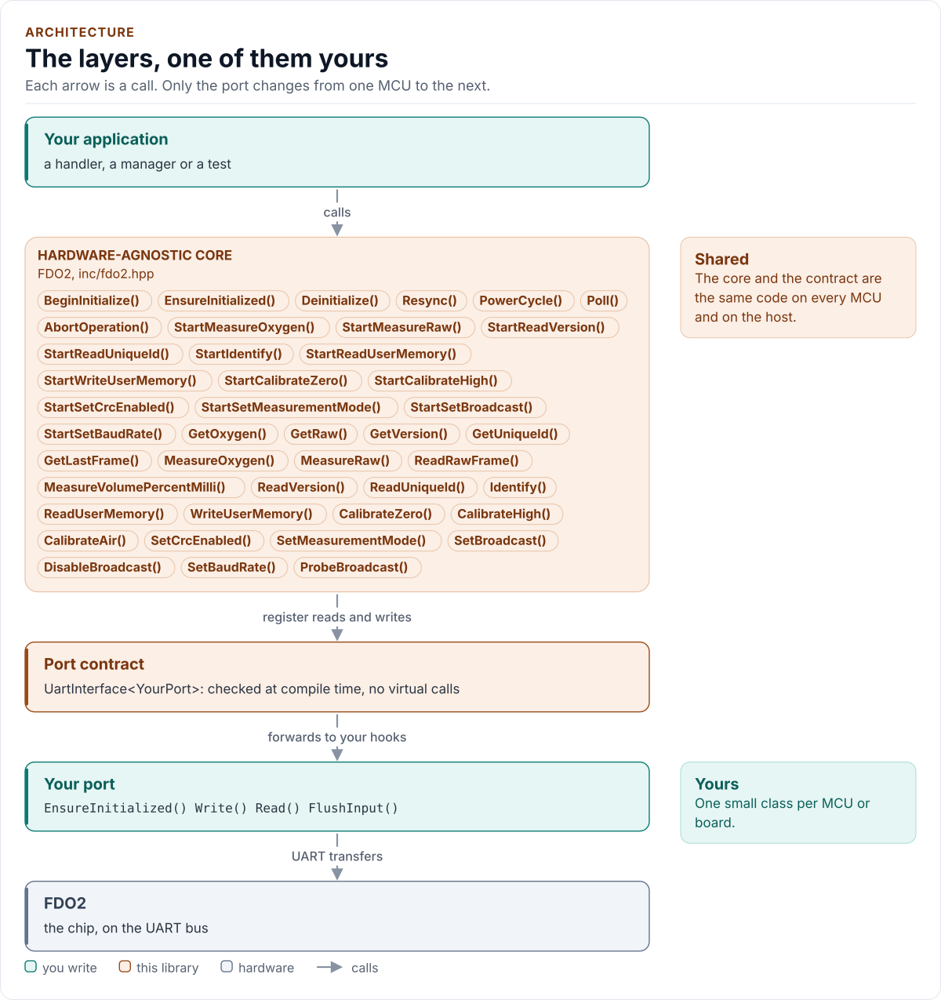
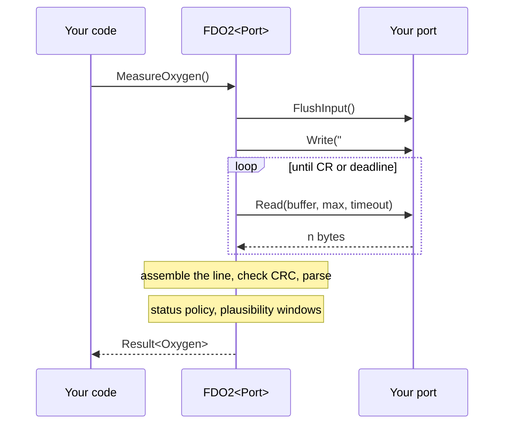

# Architecture

How the driver is built: three layers, one call through them and the choices behind them.

<!-- figure: driver-layers -->
<picture>
  <source media="(prefers-color-scheme: dark)" srcset="diagrams/driver-layers.dark.svg">
  
</picture>
<!-- /figure -->

## Layers

| Layer | Files | Owns |
| --- | --- | --- |
| Core | [`inc/fdo2.hpp`](../inc/fdo2.hpp), [`src/fdo2.ipp`](../src/fdo2.ipp) | Lifecycle, the state machine, measurements, calibration, settings, retries, errors |
| Protocol | [`inc/fdo2_protocol.hpp`](../inc/fdo2_protocol.hpp) | CRC-16, command encoding, the line assembler and the reply parser |
| Types | [`inc/fdo2_types.hpp`](../inc/fdo2_types.hpp), [`inc/fdo2_detail.hpp`](../inc/fdo2_detail.hpp) | `Error`, `Result<T>`, `Config`, `Status`, conversions, compile-time helpers |
| Port contract | [`inc/fdo2_uart_interface.hpp`](../inc/fdo2_uart_interface.hpp) | The CRTP base, `CtrlPin`, `GpioSignal`, the `UartPort` concept |
| Platform port | Your class | The UART, and optionally the clock, delay, baud rate, supply switch and log |
| Kconfig layer | [`inc/fdo2_kconfig.hpp`](../inc/fdo2_kconfig.hpp) | Optional: a `Config` from ESP-IDF menuconfig |

The protocol layer has no state and no port: the tests drive it alone.

## One call through the layers

## Design choices

- **CRTP, not virtual functions.** The port is a template parameter constrained by a concept, so every call is
  resolved at compile time and a missing hook is a compile error that names it.
- **One state machine, two ways to drive it.** The blocking calls are the start call plus a loop over `Poll()`
  with the port's delay, so both paths run the same code ([Non-blocking use](non-blocking.md)).
- **A parser that only reads.** It returns a value or a reason; the core decides what to do about it.
- **Flash writes are guarded.** Opt-in, a budget, never repeated ([Calibration](calibration.md)).
- **One error type.** `Result<T>` carries a value and an `Error`; nothing throws.
- **No heap, no exceptions, no RTTI, no `std::function`, no `printf`.** The driver is a header-only template with
  no mutable static state.

## Source map

| You want | Read |
| --- | --- |
| The public API | [`inc/fdo2.hpp`](../inc/fdo2.hpp) |
| How a call is implemented | [`src/fdo2.ipp`](../src/fdo2.ipp) |
| The command and reply grammar | [`inc/fdo2_protocol.hpp`](../inc/fdo2_protocol.hpp) |
| The port contract | [`inc/fdo2_uart_interface.hpp`](../inc/fdo2_uart_interface.hpp) |

Next: [Contract](contract.md).
