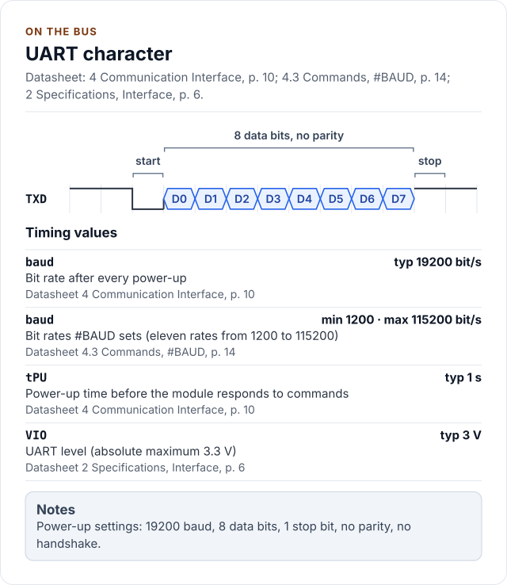
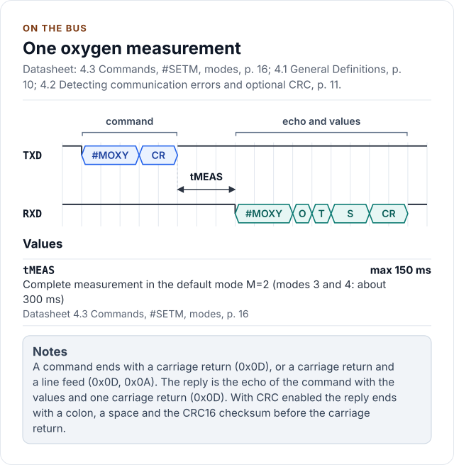

# On the bus

What the FDO2-G2 needs from the UART, with every rate and time taken from the datasheet. The commands and their
replies are on the [Protocol](protocol.md) page and the wiring on the [Hardware](hardware.md) page; this page is the
character format and the exchange under them.

<!-- generated: datasheet-refs -->
??? abstract "Datasheet sections this page relies on"

    From PyroScience Datasheet_FDO2-G2 v5:

    - Supply voltage and current: 2 Specifications, Interface, [p. 6](https://www.pyroscience.com/en/products/all-meters/fdo2-g2?file=files/website_data/Downloads/Manuals/Meters/Datasheet_FDO2-G2.pdf&cid=24457#page=6)
    - UART framing, echo and terminator: 4.1 General Definitions, [p. 10](https://www.pyroscience.com/en/products/all-meters/fdo2-g2?file=files/website_data/Downloads/Manuals/Meters/Datasheet_FDO2-G2.pdf&cid=24457#page=10)
    - Power-up time: 4 Communication Interface, [p. 10](https://www.pyroscience.com/en/products/all-meters/fdo2-g2?file=files/website_data/Downloads/Manuals/Meters/Datasheet_FDO2-G2.pdf&cid=24457#page=10)
    - CRC-16/MODBUS suffix: 4.2 Detecting communication errors and optional CRC, [p. 11](https://www.pyroscience.com/en/products/all-meters/fdo2-g2?file=files/website_data/Downloads/Manuals/Meters/Datasheet_FDO2-G2.pdf&cid=24457#page=11)
    - #MOXY: oxygen, temperature, status: 4.3 Commands, #MOXY, [p. 11](https://www.pyroscience.com/en/products/all-meters/fdo2-g2?file=files/website_data/Downloads/Manuals/Meters/Datasheet_FDO2-G2.pdf&cid=24457#page=11)
    - #BAUD: the eleven baud rates: 4.3 Commands, #BAUD, [p. 14](https://www.pyroscience.com/en/products/all-meters/fdo2-g2?file=files/website_data/Downloads/Manuals/Meters/Datasheet_FDO2-G2.pdf&cid=24457#page=14)
    - Measurement duration: 4.3 Commands, #SETM, modes, [p. 16](https://www.pyroscience.com/en/products/all-meters/fdo2-g2?file=files/website_data/Downloads/Manuals/Meters/Datasheet_FDO2-G2.pdf&cid=24457#page=16)

    All of them, with the driver API for each: [Datasheet map](datasheet.md).
<!-- /generated -->

## UART timing

After every power-up the module talks at 19200 baud with 8 data bits, no parity, one stop bit and no handshake, on
3.0 V levels (RXD tolerates 3.3 V at most). `#BAUD` sets one of eleven rates from 1200 to 115200 baud until the next
power-up. The module answers about one second after power is applied; the driver waits `Config::power_up_ms`.

<!-- figure: uart-timing -->
<picture>
  <source media="(prefers-color-scheme: dark)" srcset="diagrams/uart-timing.dark.svg">
  
</picture>
<!-- /figure -->

## One measurement

Every command ends with a carriage return. The module carries out the command, then echoes it with the requested
values and one carriage return; a measurement in the default mode takes at most 150 ms (about 300 ms in modes 3 and
4), and the driver allows `Config::measurement_ms` (300 ms by default) for it.

<!-- figure: moxy-transaction -->
<picture>
  <source media="(prefers-color-scheme: dark)" srcset="diagrams/moxy-transaction.dark.svg">
  
</picture>
<!-- /figure -->

## Several devices

The FDO2-G2 has no address: one module per UART. The datasheet speaks of several modules operated in parallel, each
on its own interface port, and offers `#LOGO` to find which module is on which port, so there is no shared-bus
figure.

## How these figures are made

Each figure is a model in `docs/model/` (`uart-timing.timing.yml` and `moxy-transaction.timing.yml`) that cites the
datasheet section and page of every number; `kokeb-docs figures` draws it and the build fails on a number without a
citation. The values table under each waveform is also written as `docs/diagrams/<id>.table.html`.
