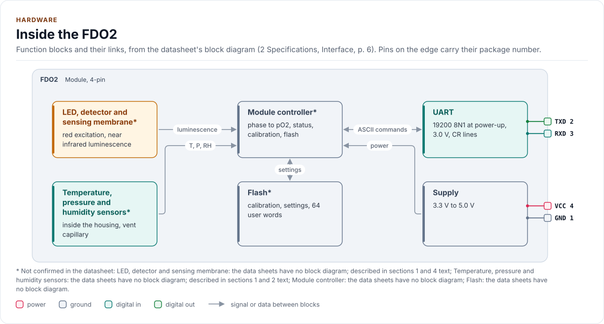
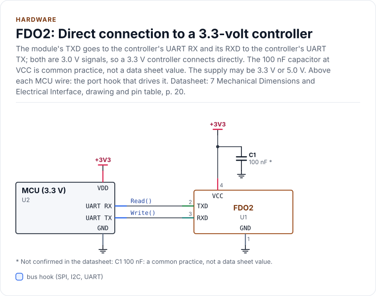
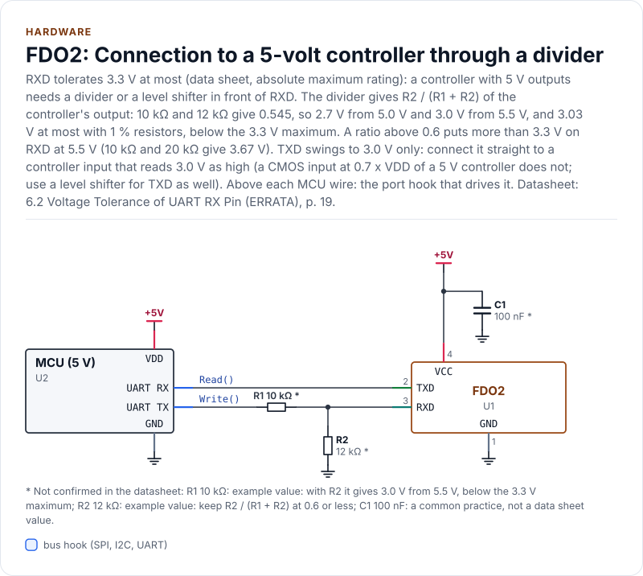
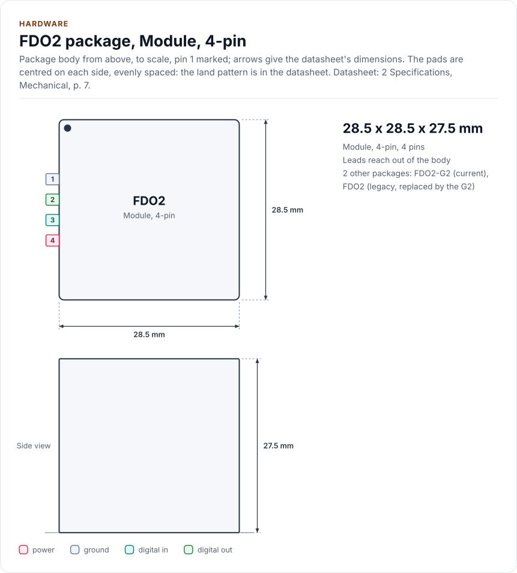
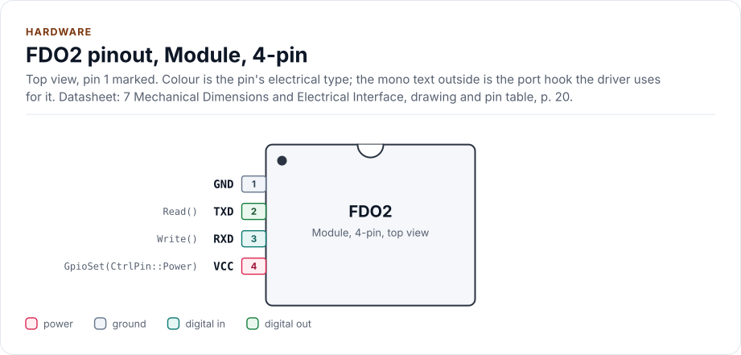
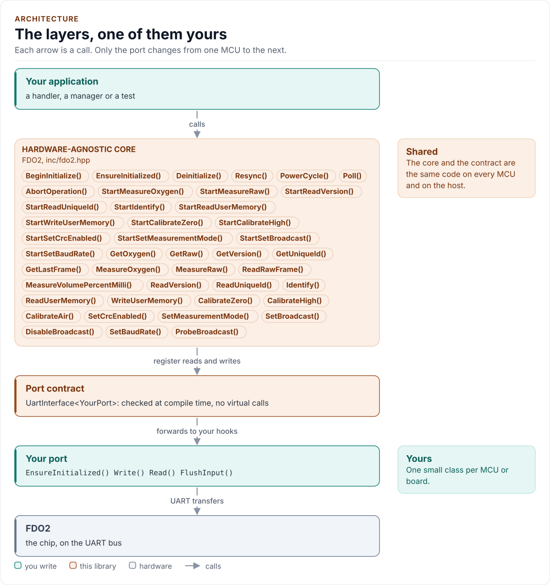
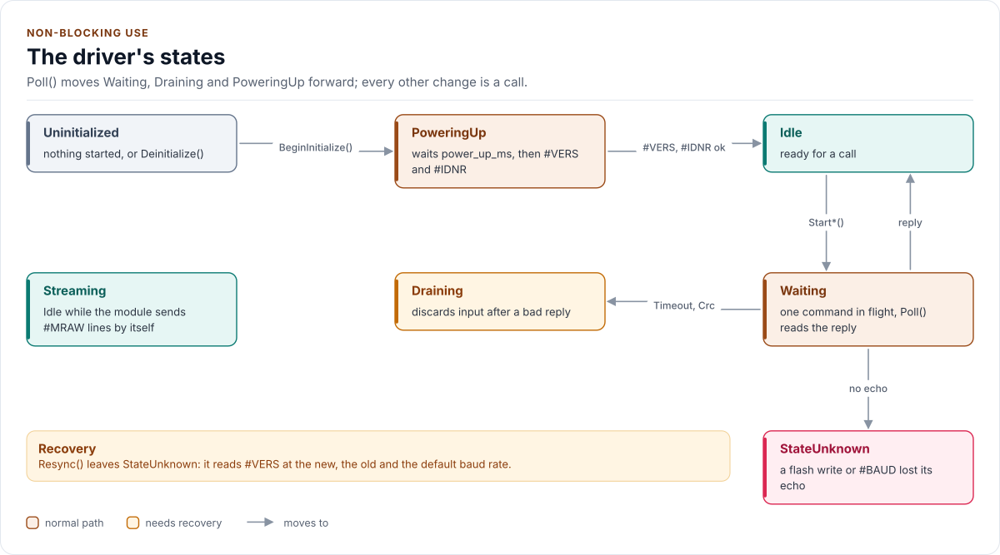
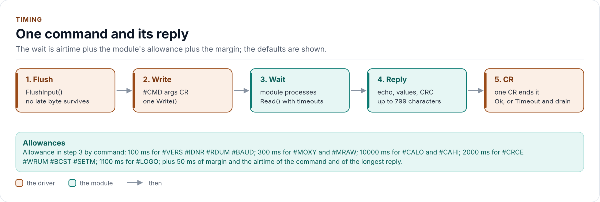

# Figures

<!-- Written by kokeb-docs figures from docs/diagrams/figures/*.py. Do not edit by hand. -->

Every figure on this site is drawn by a Python module from facts extracted from the code, so it is rebuilt,
not redrawn, when the code changes. CI runs `kokeb-docs figures --check` and fails when a
committed figure no longer matches the code. Each figure below lists the files it is drawn from.

## Inside the FDO2

<!-- figure: chip-blocks -->
<picture>
  <source media="(prefers-color-scheme: dark)" srcset="chip-blocks.dark.svg">
  
</picture>
<!-- /figure -->

Hardware description: [`docs/hardware.yml`](../hardware.yml)

Drawn from:

- [`docs/hardware.yml`](../hardware.yml)
- [`inc/fdo2_uart_interface.hpp`](../../inc/fdo2_uart_interface.hpp)

## FDO2: Direct connection to a 3.3-volt controller

<!-- figure: chip-circuit-direct -->
<picture>
  <source media="(prefers-color-scheme: dark)" srcset="chip-circuit-direct.dark.svg">
  
</picture>
<!-- /figure -->

Hardware description: [`docs/hardware.yml`](../hardware.yml)

Drawn from:

- [`docs/hardware.yml`](../hardware.yml)
- [`inc/fdo2_uart_interface.hpp`](../../inc/fdo2_uart_interface.hpp)

## FDO2: Connection to a 5-volt controller through a divider

<!-- figure: chip-circuit-shifted -->
<picture>
  <source media="(prefers-color-scheme: dark)" srcset="chip-circuit-shifted.dark.svg">
  
</picture>
<!-- /figure -->

Hardware description: [`docs/hardware.yml`](../hardware.yml)

Drawn from:

- [`docs/hardware.yml`](../hardware.yml)
- [`inc/fdo2_uart_interface.hpp`](../../inc/fdo2_uart_interface.hpp)

## FDO2 package, Module, 4-pin

<!-- figure: chip-outline -->
<picture>
  <source media="(prefers-color-scheme: dark)" srcset="chip-outline.dark.svg">
  
</picture>
<!-- /figure -->

Hardware description: [`docs/hardware.yml`](../hardware.yml)

Drawn from:

- [`docs/hardware.yml`](../hardware.yml)
- [`inc/fdo2_uart_interface.hpp`](../../inc/fdo2_uart_interface.hpp)

## FDO2 pinout, Module, 4-pin

<!-- figure: chip-pinout -->
<picture>
  <source media="(prefers-color-scheme: dark)" srcset="chip-pinout.dark.svg">
  
</picture>
<!-- /figure -->

Hardware description: [`docs/hardware.yml`](../hardware.yml)

Drawn from:

- [`docs/hardware.yml`](../hardware.yml)
- [`inc/fdo2_uart_interface.hpp`](../../inc/fdo2_uart_interface.hpp)

## The layers, one of them yours

<!-- figure: driver-layers -->
<picture>
  <source media="(prefers-color-scheme: dark)" srcset="driver-layers.dark.svg">
  
</picture>
<!-- /figure -->

Figure module: [`docs/diagrams/figures/driver-layers.py`](../../docs/diagrams/figures/driver-layers.py)

Drawn from:

- `public calls` in [`inc/fdo2.hpp`](../../inc/fdo2.hpp)
- `UartInterface` in [`inc/fdo2_uart_interface.hpp`](../../inc/fdo2_uart_interface.hpp)

## The driver's states

<!-- figure: state-machine -->
<picture>
  <source media="(prefers-color-scheme: dark)" srcset="state-machine.dark.svg">
  
</picture>
<!-- /figure -->

Figure module: [`docs/diagrams/figures/state-machine.py`](../../docs/diagrams/figures/state-machine.py)

Drawn from:

- `State` in [`inc/fdo2_types.hpp`](../../inc/fdo2_types.hpp)
- `State transitions` in [`src/fdo2.ipp`](../../src/fdo2.ipp)

## One command and its reply

<!-- figure: transaction-timing -->
<picture>
  <source media="(prefers-color-scheme: dark)" srcset="transaction-timing.dark.svg">
  
</picture>
<!-- /figure -->

Figure module: [`docs/diagrams/figures/transaction-timing.py`](../../docs/diagrams/figures/transaction-timing.py)

Drawn from:

- `Config` in [`inc/fdo2_types.hpp`](../../inc/fdo2_types.hpp)
