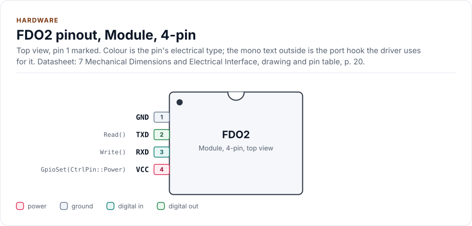
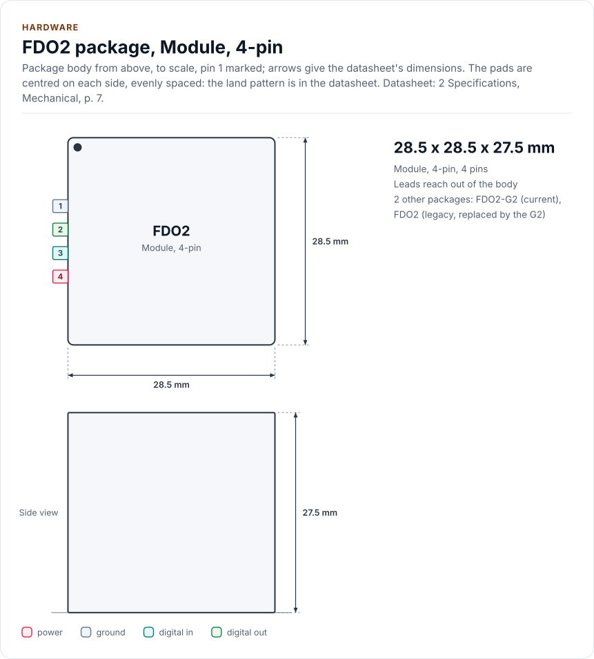
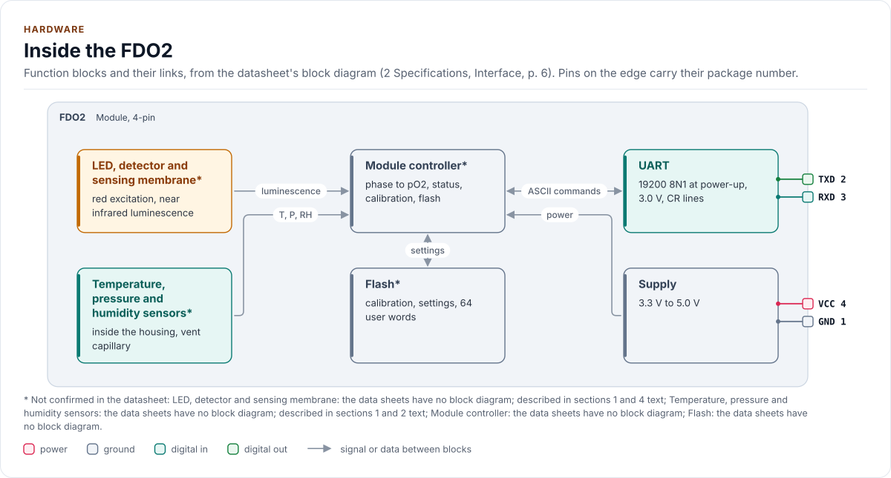
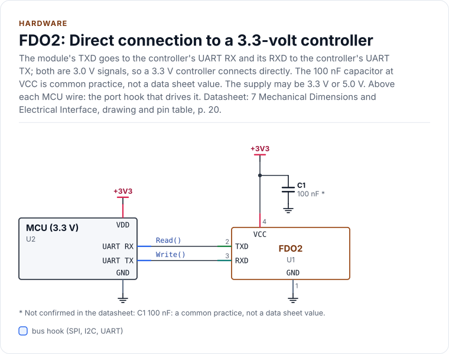
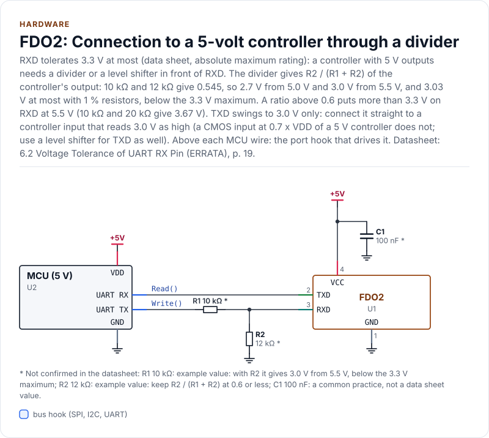

# Hardware

The FDO2 module's connector, signal levels, supply and timing, as the driver uses them.

<!-- generated: datasheet-refs -->
??? abstract "Datasheet sections this page relies on"

    - Measuring range, accuracy and warm-up: PyroScience Datasheet_FDO2-G2 v5, 2 Specifications, Analytical Performance, [p. 5](https://www.pyroscience.com/en/products/all-meters/fdo2-g2?file=files/website_data/Downloads/Manuals/Meters/Datasheet_FDO2-G2.pdf&cid=24457#page=5)
    - Supply voltage and current: PyroScience Datasheet_FDO2-G2 v5, 2 Specifications, Interface, [p. 6](https://www.pyroscience.com/en/products/all-meters/fdo2-g2?file=files/website_data/Downloads/Manuals/Meters/Datasheet_FDO2-G2.pdf&cid=24457#page=6)
    - Temperature and pressure limits, humidity: PyroScience Datasheet_FDO2-G2 v5, 2 Specifications, Environment, [p. 6](https://www.pyroscience.com/en/products/all-meters/fdo2-g2?file=files/website_data/Downloads/Manuals/Meters/Datasheet_FDO2-G2.pdf&cid=24457#page=6)
    - Mechanics, connector part and weight: PyroScience Datasheet_FDO2-G2 v5, 2 Specifications, Mechanical, [p. 7](https://www.pyroscience.com/en/products/all-meters/fdo2-g2?file=files/website_data/Downloads/Manuals/Meters/Datasheet_FDO2-G2.pdf&cid=24457#page=7)
    - Cross-sensitivity and chemical compatibility: PyroScience Datasheet_FDO2-G2 v5, 3 Cross-Sensitivity and Chemical Compatibility, [p. 8](https://www.pyroscience.com/en/products/all-meters/fdo2-g2?file=files/website_data/Downloads/Manuals/Meters/Datasheet_FDO2-G2.pdf&cid=24457#page=8)
    - Power-up time: PyroScience Datasheet_FDO2-G2 v5, 4 Communication Interface, [p. 10](https://www.pyroscience.com/en/products/all-meters/fdo2-g2?file=files/website_data/Downloads/Manuals/Meters/Datasheet_FDO2-G2.pdf&cid=24457#page=10)
    - Connector, pins and signal levels: PyroScience Datasheet_FDO2-G2 v5, 7 Mechanical Dimensions and Electrical Interface, drawing and pin table, [p. 20](https://www.pyroscience.com/en/products/all-meters/fdo2-g2?file=files/website_data/Downloads/Manuals/Meters/Datasheet_FDO2-G2.pdf&cid=24457#page=20)
    - Mechanical drawing: PyroScience Datasheet_FDO2-G2 v5, 7 Mechanical Dimensions and Electrical Interface, drawings, [p. 20](https://www.pyroscience.com/en/products/all-meters/fdo2-g2?file=files/website_data/Downloads/Manuals/Meters/Datasheet_FDO2-G2.pdf&cid=24457#page=20)
    - Supply below 3.3 V and readings: PyroScience Datasheet_FDO2 v21, 2 Specifications, Interface, WARNING, [p. 6](https://www.pyroscience.com/en/downloads/legacy?file=files/website_data/Downloads/Manuals/Meters/Datasheet_FDO2.pdf&cid=24471#page=6)
    - UART levels: 3.0 V, 3.3 V maximum on RXD: PyroScience Datasheet_FDO2 v21, 6.2 Voltage Tolerance of UART RX Pin (ERRATA), [p. 19](https://www.pyroscience.com/en/downloads/legacy?file=files/website_data/Downloads/Manuals/Meters/Datasheet_FDO2.pdf&cid=24471#page=19)
    - Replacement of the FDO2 by the FDO2-G2: PyroScience PCN-FDO2-002 n/a, Product change notification, text, [p. 1](https://www.pyroscience.com/en/products/all-meters/fdo2-g2?file=files/website_data/Downloads/Product%20Change%20Notifications/PCN-FDO2-002.pdf&cid=24463#page=1)
    - Flow-through cell accessory: PyroScience Data Sheet_FDO2_FTC n/a, Flow-through cell data sheet, whole document, [p. 1](https://www.pyroscience.com/en/products/all-meters/fdo2-g2?file=files/website_data/Downloads/Manuals/Meters/Data%20Sheet_FDO2_FTC.PDF&cid=24458#page=1)

    All of them, with the driver API for each: [Datasheet map](datasheet.md).
<!-- /generated -->

!!! warning "RXD tolerates 3.3 V at most"
    The module's UART runs at 3.0 V. The RXD pin (pin 3) must not see more than 3.3 V. A controller with 5 V
    outputs needs a divider or a level shifter in front of RXD ([the 5 V circuit](#circuits)). The legacy
    FDO2's datasheet (section 6.2, all modules) corrects an earlier "5 V tolerant" statement, found in versions up to
    17 (April 2023), to "max. 3.3 V".
    The driver cannot check the wiring; the port examples assert `kMaxLogicLevelMv` so the number is in your code.

## Pins

The module has a four-pin connector. The mating plug is the vendor's to name (see section 7 of the datasheet);
this page does not give a part number. Not verified on hardware: the wiring below follows the datasheet.

<!-- figure: chip-pinout -->
<picture>
  <source media="(prefers-color-scheme: dark)" srcset="diagrams/chip-pinout.dark.svg">
  
</picture>
<!-- /figure -->

<!-- generated: chip-pins -->
Module, 4-pin, 4 pins (7 Mechanical Dimensions and Electrical Interface, drawing and pin table, [p. 20](https://www.pyroscience.com/en/products/all-meters/fdo2-g2?file=files/website_data/Downloads/Manuals/Meters/Datasheet_FDO2-G2.pdf&cid=24457#page=20)).

| Pin | Name | Type (domain) | Function | Driver hook | If unused | Datasheet |
| --- | --- | --- | --- | --- | --- | --- |
| 1 | `GND` | ground | Ground | - | - | 7, [p. 20](https://www.pyroscience.com/en/products/all-meters/fdo2-g2?file=files/website_data/Downloads/Manuals/Meters/Datasheet_FDO2-G2.pdf&cid=24457#page=20) |
| 2 | `TXD` | digital out (UART 3.0 V) | Module transmit: 3.0 V UART data to the host (host RX) | `Read()` | Leave open | 7, [p. 20](https://www.pyroscience.com/en/products/all-meters/fdo2-g2?file=files/website_data/Downloads/Manuals/Meters/Datasheet_FDO2-G2.pdf&cid=24457#page=20) |
| 3 | `RXD` | digital in (UART 3.0 V) | Module receive: UART data from the host, 3.0 V levels, absolute maximum 3.3 V (host TX) | `Write()` | - | 7, [p. 20](https://www.pyroscience.com/en/products/all-meters/fdo2-g2?file=files/website_data/Downloads/Manuals/Meters/Datasheet_FDO2-G2.pdf&cid=24457#page=20) |
| 4 | `VCC` | power (VCC) | Supply 3.3 V to 5.0 V; below 3.3 V the oxygen readings can be wrong. Optionally switched by the port's power hook | `GpioSet(CtrlPin::Power)` | - | 7, [p. 20](https://www.pyroscience.com/en/products/all-meters/fdo2-g2?file=files/website_data/Downloads/Manuals/Meters/Datasheet_FDO2-G2.pdf&cid=24457#page=20) |

Source of this table and of the chip figures: [`docs/hardware.yml`](hardware.yml).
<!-- /generated -->

## Supply

VCC takes 3.3 V to 5.0 V. Below 3.3 V the oxygen readings can be wrong, and the module has no supply reading, so
the driver cannot detect it. After power-up the module needs about one second before it answers; the driver waits
`Config::power_up_ms` (1500 ms by default). Readings in the first three minutes have reduced accuracy:
`Oxygen::warming_up` is true for that time.

A load switch on the supply is optional. If your port has `GpioSet(CtrlPin::Power, ...)`, `PowerCycle()` switches
the supply off for `Config::power_off_ms` and on again, and `EnsureInitialized()` waits the power-up time.

## Bus settings

| Setting | Value |
| --- | --- |
| Baud rate | 19200 after every power-up; `SetBaudRate()` can raise it until the next power-up |
| Frame | 8 data bits, no parity, 1 stop bit, no handshake |
| Levels | 3.0 V; 3.3 V absolute maximum on RXD |
| Messages | ASCII, ended by one carriage return |
| Receive buffer | At least 800 bytes (`kRxBufferBytes`): the longest reply |

The commands are on the [Protocol](protocol.md) page.

## Mechanical

The module is cylindrical, 28.5 mm in diameter and 27.5 mm with the connector (datasheet section 2 and 7). Its body
is drawn in the outline figure as a square of that size, because the figure system has no round bodies yet; see
[Limitations](limitations.md#the-module-figures).

<!-- figure: chip-outline -->
<picture>
  <source media="(prefers-color-scheme: dark)" srcset="diagrams/chip-outline.dark.svg">
  
</picture>
<!-- /figure -->

## Inside the module

<!-- figure: chip-blocks -->
<picture>
  <source media="(prefers-color-scheme: dark)" srcset="diagrams/chip-blocks.dark.svg">
  
</picture>
<!-- /figure -->

The datasheets have no block diagram; this one is drawn from their text, and its blocks are marked as unverified in
[`hardware.yml`](hardware.yml).

## Circuits

<!-- figure: chip-circuit-direct -->
<picture>
  <source media="(prefers-color-scheme: dark)" srcset="diagrams/chip-circuit-direct.dark.svg">
  
</picture>
<!-- /figure -->

<!-- figure: chip-circuit-shifted -->
<picture>
  <source media="(prefers-color-scheme: dark)" srcset="diagrams/chip-circuit-shifted.dark.svg">
  
</picture>
<!-- /figure -->

<!-- generated: chip-parts -->
**Direct connection to a 3.3-volt controller** (figure `chip-circuit-direct`)

| Part | Kind | Value | Connects | Datasheet |
| --- | --- | --- | --- | --- |
| U2 | MCU (3.3 V) | - | VDD: +3V3, GND: GND, TX: MCU TX to RXD, RX: TXD to MCU RX | 7, [p. 20](https://www.pyroscience.com/en/products/all-meters/fdo2-g2?file=files/website_data/Downloads/Manuals/Meters/Datasheet_FDO2-G2.pdf&cid=24457#page=20) |
| C1 | capacitor | 100 nF (not confirmed: a common practice, not a data sheet value) | +3V3, GND | 7, [p. 20](https://www.pyroscience.com/en/products/all-meters/fdo2-g2?file=files/website_data/Downloads/Manuals/Meters/Datasheet_FDO2-G2.pdf&cid=24457#page=20) |

**Connection to a 5-volt controller through a divider** (figure `chip-circuit-shifted`)

| Part | Kind | Value | Connects | Datasheet |
| --- | --- | --- | --- | --- |
| U2 | MCU (5 V) | - | VDD: +5V, GND: GND, TX: MCU TX, RX: TXD to MCU RX | 6.2, [p. 19](https://www.pyroscience.com/en/downloads/legacy?file=files/website_data/Downloads/Manuals/Meters/Datasheet_FDO2.pdf&cid=24471#page=19) |
| R1 | resistor | 10 kΩ (not confirmed: example value: with R2 it gives 3.0 V from 5.5 V, below the 3.3 V maximum) | MCU TX, RXD | 6.2, [p. 19](https://www.pyroscience.com/en/downloads/legacy?file=files/website_data/Downloads/Manuals/Meters/Datasheet_FDO2.pdf&cid=24471#page=19) |
| R2 | resistor | 12 kΩ (not confirmed: example value: keep R2 / (R1 + R2) at 0.6 or less) | GND, RXD | 6.2, [p. 19](https://www.pyroscience.com/en/downloads/legacy?file=files/website_data/Downloads/Manuals/Meters/Datasheet_FDO2.pdf&cid=24471#page=19) |
| C1 | capacitor | 100 nF (not confirmed: a common practice, not a data sheet value) | +5V, GND | 6.2, [p. 19](https://www.pyroscience.com/en/downloads/legacy?file=files/website_data/Downloads/Manuals/Meters/Datasheet_FDO2.pdf&cid=24471#page=19) |

Export a circuit for a schematic or PCB tool: `kokeb-docs hardware --kicad-netlist OUT.net --circuit direct`.
<!-- /generated -->

The 100 nF capacitor is common practice, not a datasheet value. The divider values are an example.

## Datasheet

<!-- generated: datasheet-card -->
| Document | Revision | Get it |
| --- | --- | --- |
| Datasheet: FDO2-G2 Optical Oxygen Sensor Data Sheet (PyroScience Datasheet_FDO2-G2) | v5, 2026-03 | [PDF](https://www.pyroscience.com/en/products/all-meters/fdo2-g2?file=files/website_data/Downloads/Manuals/Meters/Datasheet_FDO2-G2.pdf&cid=24457) · [vendor page](https://www.pyroscience.com/en/products/all-meters/fdo2-g2) |
| Datasheet: FDO2 Optical Oxygen Sensor Data Sheet (legacy part) (PyroScience Datasheet_FDO2) | v21, 2025-06 | [PDF](https://www.pyroscience.com/en/downloads/legacy?file=files/website_data/Downloads/Manuals/Meters/Datasheet_FDO2.pdf&cid=24471) · [vendor page](https://www.pyroscience.com/en/downloads/legacy) |
| Product change notification: Low-pass filter and noise erratum (PyroScience PCN-FDO2-G2-001) | n/a, 2026-03 | [PDF](https://www.pyroscience.com/en/products/all-meters/fdo2-g2?file=files/website_data/Downloads/Product%20Change%20Notifications/PCN-FDO2-G2-001.pdf&cid=25762) · [vendor page](https://www.pyroscience.com/en/products/all-meters/fdo2-g2) |
| Product change notification: FDO2 replaced by FDO2-G2 (PyroScience PCN-FDO2-002) | n/a, 2025-05 | [PDF](https://www.pyroscience.com/en/products/all-meters/fdo2-g2?file=files/website_data/Downloads/Product%20Change%20Notifications/PCN-FDO2-002.pdf&cid=24463) · [vendor page](https://www.pyroscience.com/en/products/all-meters/fdo2-g2) |
| Quick start guide: Quick Start FDO2-G2 evaluation kit (PyroScience Quick_Start_FDO2-G2) | v1.00, n/a | [PDF](https://www.pyroscience.com/en/products/all-meters/fdo2-g2?file=files/website_data/Downloads/Manuals/Meters/Quick_Start_FDO2-G2.pdf&cid=24459) · [vendor page](https://www.pyroscience.com/en/products/all-meters/fdo2-g2) |
| Datasheet: FDO2-FTC flow-through cell data sheet (accessory) (PyroScience Data Sheet_FDO2_FTC) | n/a, n/a | [PDF](https://www.pyroscience.com/en/products/all-meters/fdo2-g2?file=files/website_data/Downloads/Manuals/Meters/Data%20Sheet_FDO2_FTC.PDF&cid=24458) · [vendor page](https://www.pyroscience.com/en/products/all-meters/fdo2-g2) |
| Datasheet: FDO2-EXT Modbus and analog extension module data sheet (PyroScience Datasheet_FDO2-EXT) | v5, 2025-07 | [PDF](https://www.pyroscience.com/en/products/oem-solutions/modbus-interface-adapter/fdo2-ext?file=files/website_data/Downloads/Manuals/Meters/Datasheet_FDO2-EXT.pdf&cid=19827) · [vendor page](https://www.pyroscience.com/en/products/oem-solutions/modbus-interface-adapter/fdo2-ext) |

Written against these revisions; the SHA-256 of each file is in [`docs/datasheets.yml`](datasheets.yml). Where each part
of the driver is in the datasheet: [Datasheet map](datasheet.md).
<!-- /generated -->

Next: [Protocol](protocol.md).
