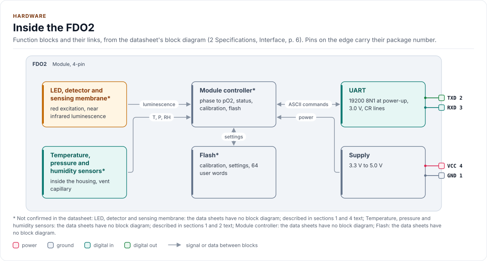
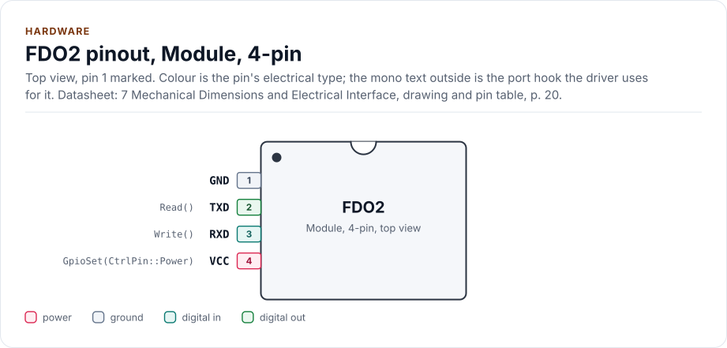
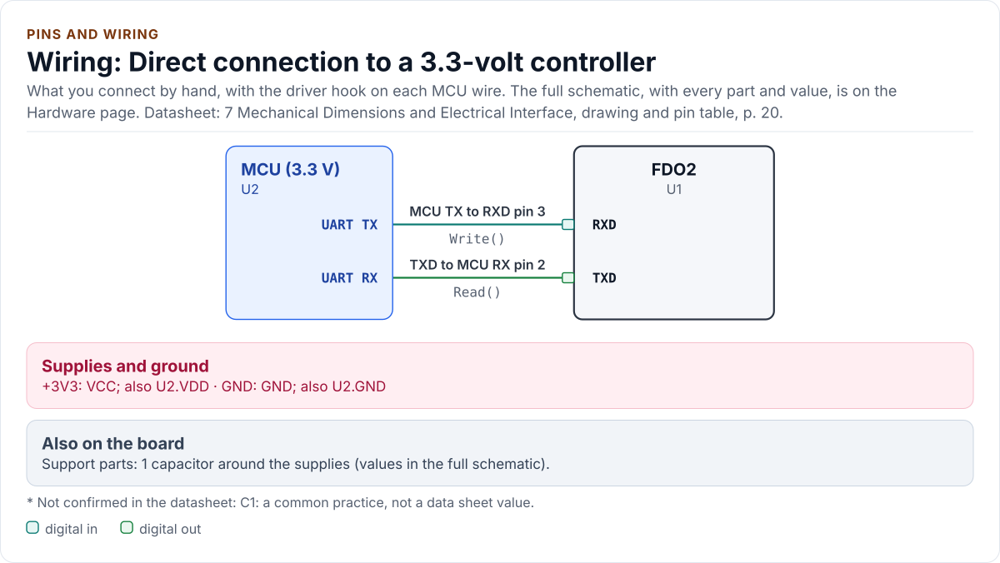
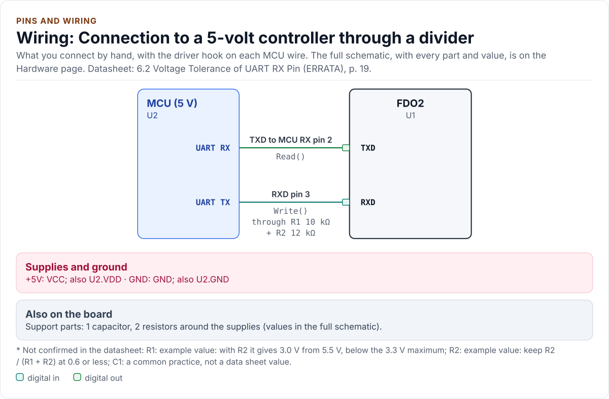

---
hide:
  - navigation
  - toc
---

<div class="kb-hero" markdown>
<span class="kb-kicker">Optical oxygen sensor module</span>

# FDO2 Driver

<p>A C++20 driver for the PyroScience FDO2-G2 and the legacy FDO2 optical oxygen modules on UART. It starts the
module, reads oxygen and temperature, checks the status word and guards the commands that write flash, on any
MCU.</p>

[Quickstart](quickstart.md){ .md-button .md-button--primary }
[API guide](api-guide.md){ .md-button }
[Source on GitHub](https://github.com/kokeb-labs-drivers/driver-fdo2){ .md-button }
</div>

<!-- generated: chip-summary -->
The **FDO2** is an optical oxygen sensor module with a UART: it excites a sensor dye with red light, measures the
luminescence that oxygen quenches, and reports the oxygen partial pressure with its temperature, compensated and factory
calibrated (1 Introduction, [p.
4](https://www.pyroscience.com/en/products/all-meters/fdo2-g2?file=files/website_data/Downloads/Manuals/Meters/Datasheet_FDO2-G2.pdf&cid=24457#page=4)).
<!-- /generated -->

<!-- figure: chip-hero -->
<picture>
  <source media="(prefers-color-scheme: dark)" srcset="diagrams/chip-hero.dark.svg">
  
</picture>
<!-- /figure -->

## What it does

<!-- figure: chip-capabilities -->
<picture>
  <source media="(prefers-color-scheme: dark)" srcset="diagrams/chip-capabilities.dark.svg">
  
</picture>
<!-- /figure -->

## Where it is used

<!-- generated: chip-uses -->
- Incubators
- Oxygen concentrators
- Inert gas processing chambers (glove boxes)
- Exhaust gas measurement
- Inert gas monitoring
- Portable equipment
- Monitoring fruit storage and transport
- Biogas applications
- Oxygen level monitoring in buildings

Uses named by the datasheet (1 Introduction, [p. 4](https://www.pyroscience.com/en/products/all-meters/fdo2-g2?file=files/website_data/Downloads/Manuals/Meters/Datasheet_FDO2-G2.pdf&cid=24457#page=4)).
<!-- /generated -->

## Inside the module

<!-- figure: chip-blocks -->
<picture>
  <source media="(prefers-color-scheme: dark)" srcset="diagrams/chip-blocks.dark.svg">
  
</picture>
<!-- /figure -->

## Pins and wiring

<!-- figure: chip-pinout -->
<picture>
  <source media="(prefers-color-scheme: dark)" srcset="diagrams/chip-pinout.dark.svg">
  
</picture>
<!-- /figure -->

<!-- figure: chip-wiring-direct -->
<picture>
  <source media="(prefers-color-scheme: dark)" srcset="diagrams/chip-wiring-direct.dark.svg">
  
</picture>
<!-- /figure -->

<!-- figure: chip-wiring-shifted -->
<picture>
  <source media="(prefers-color-scheme: dark)" srcset="diagrams/chip-wiring-shifted.dark.svg">
  
</picture>
<!-- /figure -->

Every pin, both circuits, the UART settings and the mechanical data: [Hardware](hardware.md).

## Quick start

Wire the module as above, write the port ([Porting](porting.md)), then measure the oxygen:

```cpp
--8<-- "tests/docs/quickstart.cpp:quickstart"
```

The steps explained: [Quickstart](quickstart.md).

## Driver coverage

<!-- generated: chip-coverage -->
| Capability | What the chip does | Driver API | Registers | Status | Datasheet |
| --- | --- | --- | --- | --- | --- |
| [Oxygen and temperature](api-guide.md) | Measures the oxygen partial pressure and the temperature, as hPa or as a volume fraction | `MeasureOxygen`, `StartMeasureOxygen`, `GetOxygen`, `MeasureVolumePercentMilli` | `MOXY` | Supported | 4.3, [p. 11](https://www.pyroscience.com/en/products/all-meters/fdo2-g2?file=files/website_data/Downloads/Manuals/Meters/Datasheet_FDO2-G2.pdf&cid=24457#page=11) |
| [Raw values and housing sensors](api-guide.md) | Adds the phase shift, signal and ambient light, and the pressure and humidity inside the housing | `MeasureRaw`, `StartMeasureRaw`, `ReadRawFrame`, `GetRaw` | `MRAW` | Supported | 4.3, [p. 12](https://www.pyroscience.com/en/products/all-meters/fdo2-g2?file=files/website_data/Downloads/Manuals/Meters/Datasheet_FDO2-G2.pdf&cid=24457#page=12) |
| [Status word](status-and-errors.md) | Classifies each reading's warning and fatal bits and holds back a faulty measurement | `Classify` | - | Supported | 4.3, [p. 12](https://www.pyroscience.com/en/products/all-meters/fdo2-g2?file=files/website_data/Downloads/Manuals/Meters/Datasheet_FDO2-G2.pdf&cid=24457#page=12) |
| [Identity and start-up](protocol.md) | Waits out the power-up, reads the version and the unique ID, and flashes the status LED to find a module | `EnsureInitialized`, `ReadVersion`, `ReadUniqueId`, `Identify`, `Resync`, `PowerCycle` | `VERS`, `IDNR`, `LOGO` | Supported | 4.3, [p. 11](https://www.pyroscience.com/en/products/all-meters/fdo2-g2?file=files/website_data/Downloads/Manuals/Meters/Datasheet_FDO2-G2.pdf&cid=24457#page=11) |
| [Calibration](calibration.md) | Calibrates at zero oxygen, at a known partial pressure or in dry air; the factory calibration is lost | `CalibrateZero`, `CalibrateHigh`, `CalibrateAir` | `CALO`, `CAHI` | Guarded | 4.3, [p. 14](https://www.pyroscience.com/en/products/all-meters/fdo2-g2?file=files/website_data/Downloads/Manuals/Meters/Datasheet_FDO2-G2.pdf&cid=24457#page=14) |
| [Broadcast stream](settings.md) | Makes the module measure by itself at a set interval and send each result | `SetBroadcast`, `DisableBroadcast`, `ProbeBroadcast` | `BCST` | Guarded | 4.3, [p. 15](https://www.pyroscience.com/en/products/all-meters/fdo2-g2?file=files/website_data/Downloads/Manuals/Meters/Datasheet_FDO2-G2.pdf&cid=24457#page=15) |
| [Measurement mode, CRC and baud rate](settings.md) | Trades drift for noise, adds a CRC-16 to every reply, and changes the baud rate | `SetMeasurementMode`, `SetCrcEnabled`, `SetBaudRate` | `SETM`, `CRCE`, `BAUD` | Guarded | 4.3, [p. 15](https://www.pyroscience.com/en/products/all-meters/fdo2-g2?file=files/website_data/Downloads/Manuals/Meters/Datasheet_FDO2-G2.pdf&cid=24457#page=15) |
| [User memory](settings.md) | Reads and writes 64 words that survive a power cycle; each write costs a flash cycle | `ReadUserMemory`, `WriteUserMemory` | `RDUM`, `WRUM` | Guarded | 4.3, [p. 14](https://www.pyroscience.com/en/products/all-meters/fdo2-g2?file=files/website_data/Downloads/Manuals/Meters/Datasheet_FDO2-G2.pdf&cid=24457#page=14) |

**Supported**: the driver covers it and a host test checks it; **Guarded**: covered, behind an explicit acknowledgement
because a wrong value can do harm.

From [`docs/hardware.yml`](hardware.yml); `kokeb-docs hardware --check` confirms that every API name is in
`inc/fdo2.hpp`, `inc/fdo2_types.hpp` and every register in `inc/fdo2_protocol.hpp`.
<!-- /generated -->

The driver has no platform code. You give it a small class that moves bytes on the UART; it does the rest: the
power-up wait, the command lines, the checksum, the status policy, retries and timeouts.

- **One object per module.** `FDO2<YourPort>` takes a reference to your port and does no I/O until
  `EnsureInitialized()`. See [API guide](api-guide.md).
- **Errors you can act on.** Every call returns `Result<T>` with an `Error` such as `Timeout`, `SensorFault` or
  `NotPermitted`. See [Status and errors](status-and-errors.md).
- **Flash writes need your consent.** Calibration and settings write the module's flash; the driver sends them only
  with an opt-in and inside a budget. See [Calibration](calibration.md).
- **Datasheet defaults.** `Config{}` follows the datasheets, with units in the field names. See
  [Configuration](configuration.md).
- **Blocking or not.** Every operation has a blocking call and a start call with `Poll()`. See
  [Non-blocking use](non-blocking.md).
- **Zero-overhead portability.** The port is a CRTP class checked by a concept. See [Porting](porting.md).
- **No heap, no exceptions, no RTTI.** See [Contract](contract.md).
- **Tested without hardware.** The host tests run the driver against a model of the module written from the
  datasheets; it has not been run on a real module ([Limitations](limitations.md)).

## Datasheet

<!-- generated: datasheet-card -->
| Document | Revision | Get it |
| --- | --- | --- |
| Datasheet: FDO2-G2 Optical Oxygen Sensor Data Sheet (PyroScience Datasheet_FDO2-G2) | v5, 2026-03 | [PDF](https://www.pyroscience.com/en/products/all-meters/fdo2-g2?file=files/website_data/Downloads/Manuals/Meters/Datasheet_FDO2-G2.pdf&cid=24457) · [vendor page](https://www.pyroscience.com/en/products/all-meters/fdo2-g2) |
| Datasheet: FDO2 Optical Oxygen Sensor Data Sheet (legacy part) (PyroScience Datasheet_FDO2) | v21, 2025-06 | [PDF](https://www.pyroscience.com/en/downloads/legacy?file=files/website_data/Downloads/Manuals/Meters/Datasheet_FDO2.pdf&cid=24471) · [vendor page](https://www.pyroscience.com/en/downloads/legacy) |
| Product change notification: Low-pass filter and noise erratum (PyroScience PCN-FDO2-G2-001) | n/a, 2026-03 | [PDF](https://www.pyroscience.com/en/products/all-meters/fdo2-g2?file=files/website_data/Downloads/Product%20Change%20Notifications/PCN-FDO2-G2-001.pdf&cid=25762) · [vendor page](https://www.pyroscience.com/en/products/all-meters/fdo2-g2) |
| Product change notification: FDO2 replaced by FDO2-G2 (PyroScience PCN-FDO2-002) | n/a, 2025-05 | [PDF](https://www.pyroscience.com/en/products/all-meters/fdo2-g2?file=files/website_data/Downloads/Product%20Change%20Notifications/PCN-FDO2-002.pdf&cid=24463) · [vendor page](https://www.pyroscience.com/en/products/all-meters/fdo2-g2) |
| Quick start guide: Quick Start FDO2-G2 evaluation kit (PyroScience Quick_Start_FDO2-G2) | v1.00, n/a | [PDF](https://www.pyroscience.com/en/products/all-meters/fdo2-g2?file=files/website_data/Downloads/Manuals/Meters/Quick_Start_FDO2-G2.pdf&cid=24459) · [vendor page](https://www.pyroscience.com/en/products/all-meters/fdo2-g2) |
| Datasheet: FDO2-FTC flow-through cell data sheet (accessory) (PyroScience Data Sheet_FDO2_FTC) | n/a, n/a | [PDF](https://www.pyroscience.com/en/products/all-meters/fdo2-g2?file=files/website_data/Downloads/Manuals/Meters/Data%20Sheet_FDO2_FTC.PDF&cid=24458) · [vendor page](https://www.pyroscience.com/en/products/all-meters/fdo2-g2) |
| Datasheet: FDO2-EXT Modbus and analog extension module data sheet (PyroScience Datasheet_FDO2-EXT) | v5, 2025-07 | [PDF](https://www.pyroscience.com/en/products/oem-solutions/modbus-interface-adapter/fdo2-ext?file=files/website_data/Downloads/Manuals/Meters/Datasheet_FDO2-EXT.pdf&cid=19827) · [vendor page](https://www.pyroscience.com/en/products/oem-solutions/modbus-interface-adapter/fdo2-ext) |

Written against these revisions; the SHA-256 of each file is in [`docs/datasheets.yml`](datasheets.yml). Where each part
of the driver is in the datasheet: [Datasheet map](datasheet.md).
<!-- /generated -->

## Where to go next

<div class="grid cards" markdown>

-   :material-rocket-launch-outline: **[Quickstart](quickstart.md)**

    ---

    Wire the module, write the port, read the oxygen in about 15 lines.

-   :material-chip: **[Hardware](hardware.md)**

    ---

    Connector, levels, supply and the 5 V circuit.

-   :material-file-document-check-outline: **[Contract](contract.md)**

    ---

    What the driver promises, what it needs and threading.

-   :material-code-braces: **[API guide](api-guide.md)**

    ---

    Start, measure, read the identity and handle errors, task by task.

-   :material-swap-horizontal: **[Porting](porting.md)**

    ---

    Implement the port for your UART.

-   :material-book-open-variant: **[API reference](api-reference.md)**

    ---

    Every class and member, generated from the headers.

</div>
