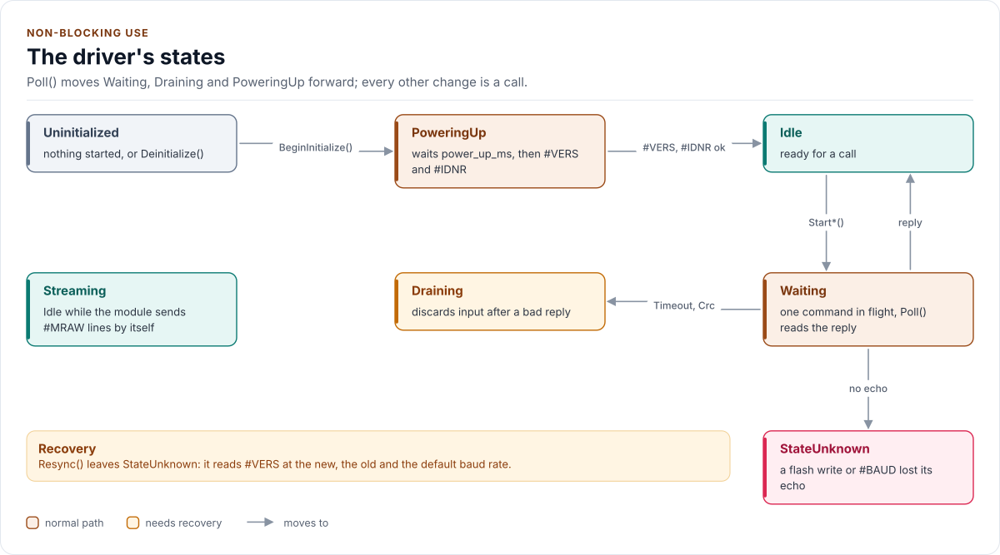
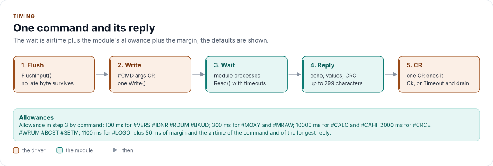

# Non-blocking use

How to run the driver from a super-loop or a task without waiting inside a call.

<!-- generated: datasheet-refs -->
??? abstract "Datasheet sections this page relies on"

    From PyroScience Datasheet_FDO2-G2 v5:

    - Power-up time: 4 Communication Interface, [p. 10](https://www.pyroscience.com/en/products/all-meters/fdo2-g2?file=files/website_data/Downloads/Manuals/Meters/Datasheet_FDO2-G2.pdf&cid=24457#page=10)
    - #BCST: broadcast mode: 4.3 Commands, #BCST, [p. 15](https://www.pyroscience.com/en/products/all-meters/fdo2-g2?file=files/website_data/Downloads/Manuals/Meters/Datasheet_FDO2-G2.pdf&cid=24457#page=15)
    - Measurement duration: 4.3 Commands, #SETM, modes, [p. 16](https://www.pyroscience.com/en/products/all-meters/fdo2-g2?file=files/website_data/Downloads/Manuals/Meters/Datasheet_FDO2-G2.pdf&cid=24457#page=16)

    All of them, with the driver API for each: [Datasheet map](datasheet.md).
<!-- /generated -->

## Two ways to call

Every operation has a blocking form and a start form:

| Blocking | Start | Result |
| --- | --- | --- |
| `EnsureInitialized()` | `BeginInitialize()` | `Identity` |
| `MeasureOxygen()` | `StartMeasureOxygen()` | `GetOxygen()` |
| `MeasureRaw()` | `StartMeasureRaw()` | `GetRaw()` |
| `CalibrateZero()`, `CalibrateHigh()` | `StartCalibrateZero()`, `StartCalibrateHigh()` | none |
| `SetCrcEnabled()`, `SetBroadcast()`, `SetBaudRate()`, `SetMeasurementMode()` | `Start...()` | none |
| `ReadUserMemory()`, `WriteUserMemory()` | `StartReadUserMemory()`, `StartWriteUserMemory()` | `GetUserMemory()` |

The blocking forms need the port's `DelayUs` hook: calling one from a port without it is a compile error. They
wait for the module's reply, which takes up to 300 ms for a measurement and up to 10 s for a calibration.

## Poll

A start call sends the request and returns. `Poll()` then reads what has arrived and moves the state forward. It
returns `Ok(false)` while the operation is pending, `Ok(true)` when it ended, and an error when it failed.

- With a clock in the port (`NowUs`), call `Poll()` with no argument; it measures its own time.
- Without one, call `Poll(elapsed_us)` with the time since the last call.

```cpp title="non_blocking.cpp"
--8<-- "tests/docs/non_blocking.cpp:super-loop"
```

```cpp title="non_blocking.cpp"
--8<-- "tests/docs/non_blocking.cpp:with-clock"
```

Only one operation runs at a time. A start call while one is pending returns `Busy`. `Pending()` names it and
`AbortOperation()` drops it.

## States

`GetState()` returns one of seven states.

<!-- figure: state-machine -->
<picture>
  <source media="(prefers-color-scheme: dark)" srcset="diagrams/state-machine.dark.svg">
  
</picture>
<!-- /figure -->

| State | Meaning |
| --- | --- |
| `Uninitialized` | Nothing started, or `Deinitialize()` ran |
| `PoweringUp` | Waiting for the module's power-up (`Config::power_up_ms`) |
| `Idle` | Ready for a call |
| `Waiting` | A request is out; waiting for its reply (a flash write first runs a guard read) |
| `Streaming` | The module sends `#MRAW` lines by itself |
| `Draining` | Waiting for bytes of a late reply to stop before the next request |
| `StateUnknown` | A flash write or baud change ended with no echo; `Resync()` |

`Deinitialize()` returns `Busy` while a flash write may still be running, that is until its echo has arrived or its
allowance has run down. On a port without `NowUs()` the time moves only through `Poll(elapsed_us)`, so a caller
that does not poll stays `Busy`; `FlashWritePending()` shows whether the wait is over.

## Timing of one request

<!-- figure: transaction-timing -->
<picture>
  <source media="(prefers-color-scheme: dark)" srcset="diagrams/transaction-timing.dark.svg">
  
</picture>
<!-- /figure -->

The deadline of a request is the allowance for its command (`measurement_ms`, `calibration_ms`, `flash_ms`, ...)
plus the time the line needs for the bytes plus `Config::margin_ms`.

Next: [Status and errors](status-and-errors.md).
